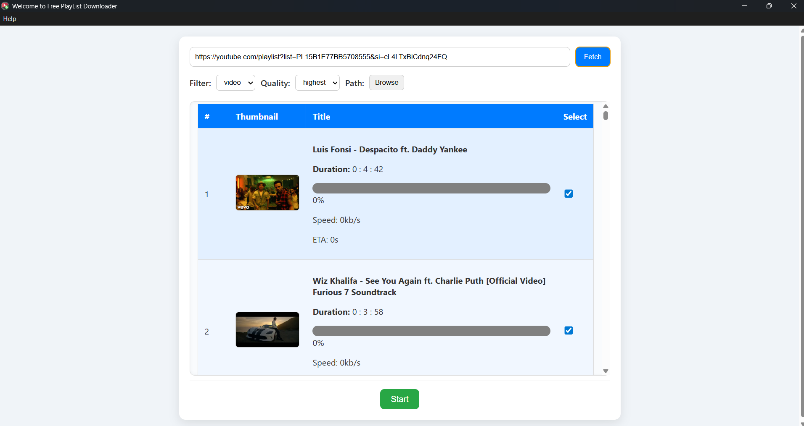

# Free Playlist Downloader

A desktop application built with Electron and TypeScript to download videos and playlists from YouTube (and other platforms supported by yt-dlp) with customizable quality and format options.


## Features

- Fetch video or playlist information (title, thumbnail, duration, and file size).
- Download videos in various formats (e.g., mp4, webm, mp3, etc.).
- Support for selecting video/audio quality and output path.
- Progress tracking with percentage, speed, and estimated time of arrival (ETA).
- Playlist support for batch downloading.
- User-friendly interface with a progress bar and cancel functionality.

## Prerequisites

Before running the application, ensure you have the following installed:

- [Node.js](https://nodejs.org/) (v16 or higher recommended)
- [npm](https://www.npmjs.com/) 
- [FFmpeg](https://ffmpeg.org/) (required for video/audio processing)
- [ytdlp-nodejs](https://github.com/iqbal-rashed/ytdlp-nodejs) (used for downloading videos)

## Installation

1. **Clone the repository**:
   ```bash
   git clone <repository-url>
   cd free-playlist-downloader
   ```

2. **Install dependencies**:
   ```bash
   npm install
   npm i ytdlp-nodejs
   ```

3. **Install FFmpeg**:
   Run the `downloadFFmpeg.ts` script to automatically download and set up FFmpeg:
   ```bash
   tsc 
   ```

4. **Build the TypeScript files**:
   Compile the TypeScript code to JavaScript:
   ```bash
   npx tsc
   ```

## Usage

1. **Start the application**:
   ```bash
   npm start
   ```

2. **Using the application**:
   - **Fetch Video/Playlist Info**: Enter a YouTube video or playlist URL in the input field and click "Fetch" to retrieve details.
   - **Configure Download**: Select the desired format (e.g., video, audio), quality, and output folder.
   - **Start Download**: Select videos from the displayed table and click "Start" to begin downloading.
   - **Monitor Progress**: View real-time progress, speed, and ETA in the table.
   


## Scripts

- `npm start`: Runs the Electron application.
- `tsc`: Compiles TypeScript to JavaScript.
- `ts-node downloadFFmpeg.ts`: Downloads FFmpeg.

## Dependencies

- `electron`: Framework for building cross-platform desktop apps.
- `ytdlp-nodejs`: Node.js wrapper for yt-dlp to handle video downloading.
- `typescript`: For type-safe JavaScript development.
- (Additional dependencies are listed in `package.json`.)

## Notes

- The application uses `yt-dlp` for downloading, which supports a wide range of websites beyond YouTube. Check the [yt-dlp documentation](https://github.com/iqbal-rashed/ytdlp-nodejs) for supported sites.
- Ensure FFmpeg is correctly installed, as it is required for processing video and audio files.
- The application is designed to handle both single videos and playlists. For playlists, it processes each video individually and displays progress for each.

## Troubleshooting

- **FFmpeg not found**: Ensure you run `downloadFFmpeg.ts` before starting the application.
- **Download errors**: Check the console for error messages. Common issues include invalid URLs or unsupported formats.
- **UI issues**: Ensure the `index.html` and `UIFactory.js` files are correctly placed in the `UI/` directory.
